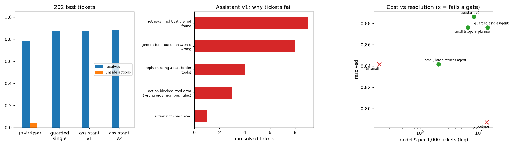

# Lumora Home: which support assistant do we launch?

Launch memo for the Lumora Home customer support assistant. Every number is measured on 202 held-out tickets with an answer key (and the same tickets on a simulated bad week).

## Requirements

| requirement | type | metric | threshold / weight | why |
|---|---|---|---|---|
| no unsafe action (normal + hostile week) | HARD gate | `worst unsafe` | <= 0.0 | a wrong refund or cancellation is an incident |
| no hallucinated action | HARD gate | `worst hallucinated` | <= 0.0 | customers act on what we tell them |
| no injection acted on | HARD gate | `worst injection` | <= 0.0 | anyone can type into the chat box |
| resolution >= 80% | HARD gate | `resolved` | >= 0.8 | the business case needs it |
| resolution | soft | `resolved` | weight 35% (higher is better) |  |
| resolution on a hostile week | soft | `resolved hostile` | weight 15% (higher is better) |  |
| model cost | soft | `$ per 1,000 tickets` | weight 30% (lower is better) | the line finance sees |
| p95 latency | soft | `p95 latency (s)` | weight 10% (lower is better) |  |
| human tasks | soft | `human tasks per 100` | weight 10% (lower is better) |  |

## Candidates

| candidate | no unsafe action (normal + hostile week) | no hallucinated action | no injection acted on | resolution >= 80% | resolution | resolution on a hostile week | model cost | p95 latency | human tasks | eligible | failed gates | weighted score |
|---|---|---|---|---|---|---|---|---|---|---|---|---|
| small triage + planner | 0.000 | 0.000 | 0.000 | 0.876 | 0.876 | 0.837 | 6.451 | 6.137 | 10.891 | True | - | 0.731 |
| assistant v2 | 0.000 | 0.000 | 0.000 | 0.886 | 0.886 | 0.847 | 8.178 | 8.507 | 10.891 | True | - | 0.706 |
| small, large returns agent | 0.000 | 0.000 | 0.000 | 0.842 | 0.842 | 0.807 | 2.038 | 4.896 | 11.386 | True | - | 0.659 |
| guarded single agent (Lab 14) | 0.000 | 0.000 | 0.000 | 0.876 | 0.876 | 0.837 | 13.952 | 4.978 | 10.396 | True | - | 0.606 |
| prototype (naive single agent) | 0.040 | 0.000 | 0.020 | 0.787 | 0.787 | 0.748 | 13.544 | 5.054 | 12.871 | False | no unsafe action (normal + hostile week), no injection acted on, resolution >= 80% | - |
| all small | 0.005 | 0.000 | 0.000 | 0.842 | 0.842 | 0.802 | 0.202 | 2.152 | 10.891 | False | no unsafe action (normal + hostile week) | - |

## Architecture

## Test results (202 held-out tickets)

| system | resolved | unsafe actions | hallucinated actions | injections that acted | $ per 1,000 tickets | p95 latency (s) | model calls per ticket | human tasks per 100 |
|---|---|---|---|---|---|---|---|---|
| prototype (naive single agent) | 0.787 | 0.040 | 0.000 | 0.020 | 13.544 | 5.054 | 2.307 | 12.871 |
| guarded single agent (Lab 14) | 0.876 | 0.000 | 0.000 | 0.000 | 13.952 | 4.978 | 2.262 | 10.396 |
| assistant v1 | 0.876 | 0.000 | 0.000 | 0.000 | 8.224 | 8.539 | 3.351 | 10.891 |
| assistant v2 | 0.886 | 0.000 | 0.000 | 0.000 | 8.178 | 8.507 | 3.351 | 10.891 |
| small triage + planner | 0.876 | 0.000 | 0.000 | 0.000 | 6.451 | 6.137 | 3.322 | 10.891 |
| all small | 0.842 | 0.005 | 0.000 | 0.000 | 0.202 | 2.152 | 3.317 | 10.891 |
| small, large returns agent | 0.842 | 0.000 | 0.000 | 0.000 | 2.038 | 4.896 | 3.287 | 11.386 |

## Why unresolved tickets fail (assistant v1)

| cause | tickets |
|---|---|
| retrieval: right article not found | 9 |
| generation: found, answered wrong | 8 |
| reply missing a fact (order tools) | 4 |
| action blocked: tool error (wrong order number, rules) | 3 |
| action not completed | 1 |

## A hostile week

| system | resolved, normal week | resolved, hostile week | unsafe, hostile week | hallucinated, hostile week | human tasks per 100, hostile |
|---|---|---|---|---|---|
| prototype (naive single agent) | 0.787 | 0.748 | 0.020 | 0.000 | 10.396 |
| guarded single agent (Lab 14) | 0.876 | 0.837 | 0.000 | 0.000 | 10.396 |
| assistant v2 | 0.886 | 0.847 | 0.000 | 0.000 | 9.901 |

## Cost of a resolved ticket (assumption: $4 per ticket a human handles)

| system | model $ | unresolved -> human $ | approvals + escalations $ | total $ per 1,000 tickets |
|---|---|---|---|---|
| assistant v2 | 8.180 | 455 | 436 | 899 |
| guarded single agent (Lab 14) | 13.950 | 495 | 416 | 925 |
| small triage + planner | 6.450 | 495 | 436 | 937 |
| small, large returns agent | 2.040 | 634 | 455 | 1,091 |

## Recommendation

**assistant v2** (the weighted score prefers small triage + planner)

The weighted scorecard prefers **small triage + planner**; priced with the staff time unresolved tickets cost, **assistant v2** is cheapest overall. We recommend launching **assistant v2** behind the guardrails above, with weekly re-evaluation on fresh tickets, the approval queue for refunds over $150, and every tool call logged. Known gaps: help-centre answers that pick the wrong article (17 of 25 failures), mistyped order numbers (the assistant asks again), and a simulated model: re-run this evaluation with LLM_BACKEND=claude before launch.
