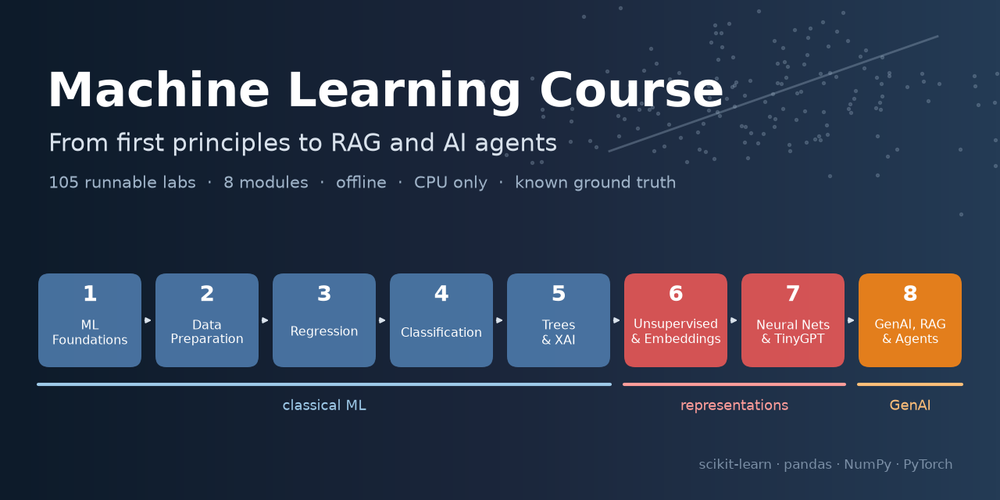
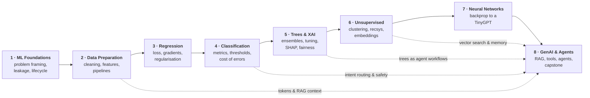
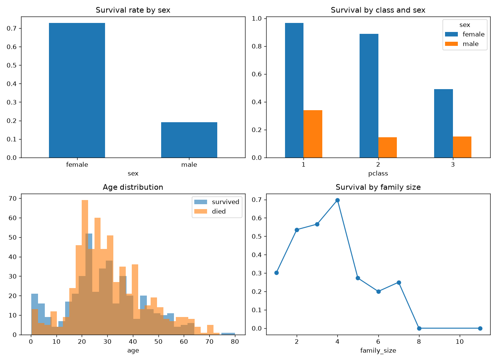
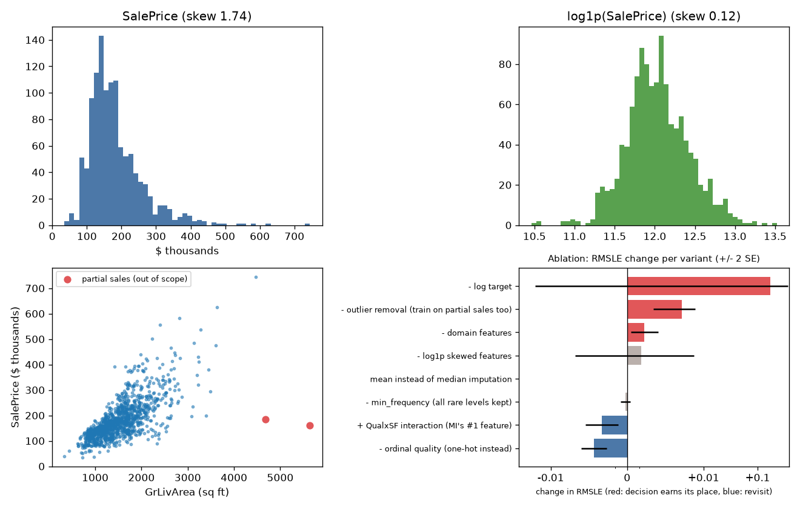
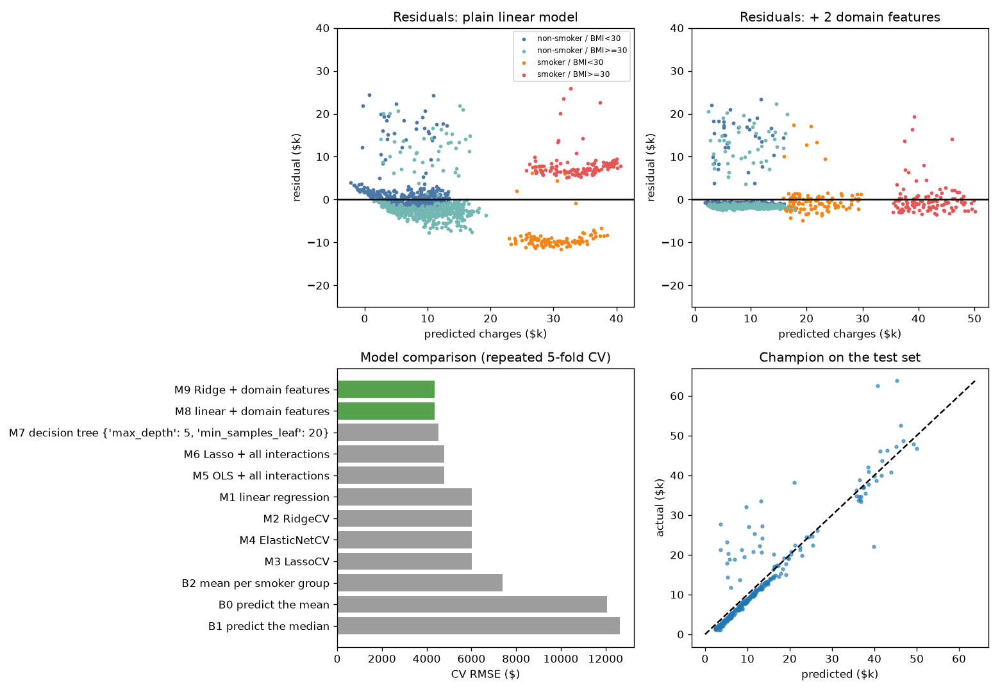
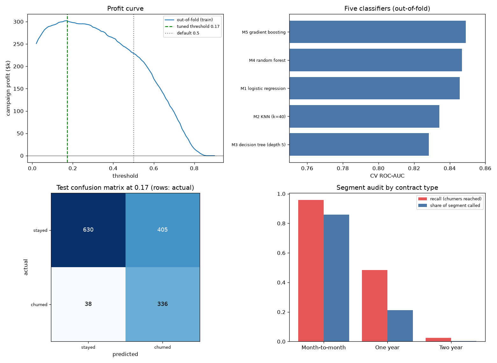
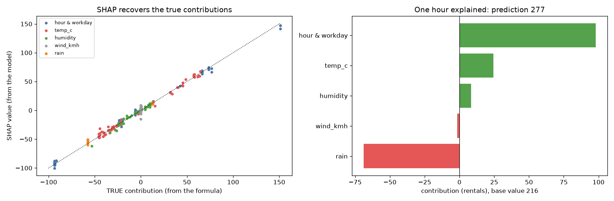
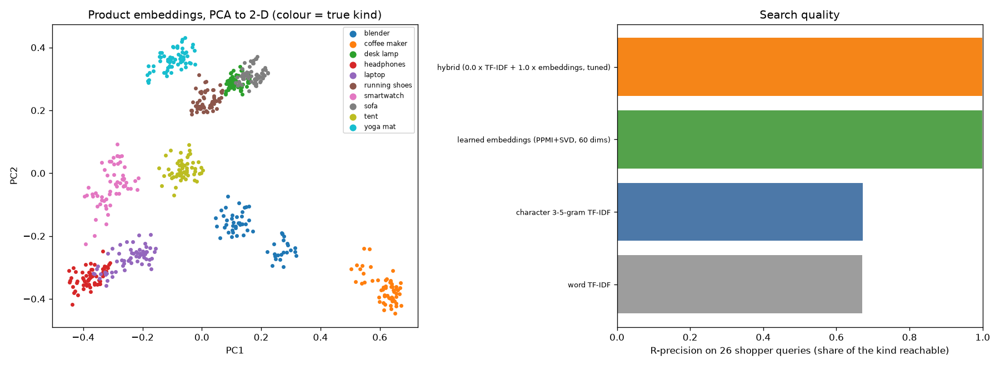
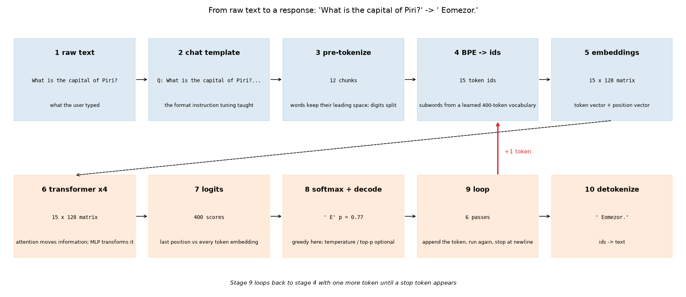
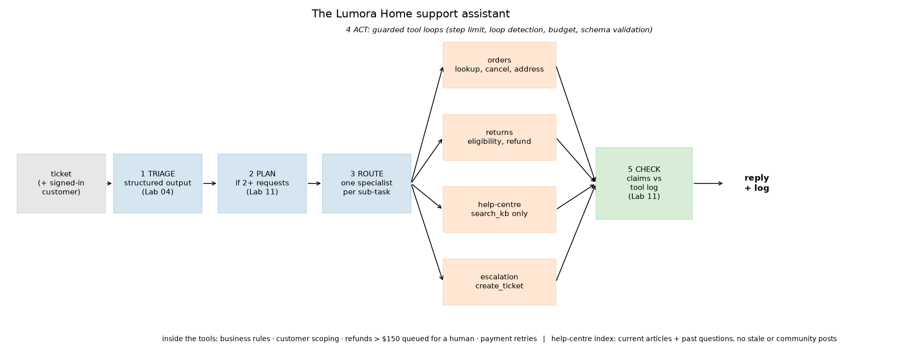

<div align="center">



# Machine Learning Course: From First Principles to Agentic AI

**105 runnable labs across 8 modules: data and classical ML, then neural networks, then LLMs, RAG and AI agents.**
<br>Every lab runs offline on a laptop CPU, uses data with a known ground truth, and ends with a result you can check.

[](https://codespaces.new/kripasharmaleadership-ai/Machine-Learning-Course?quickstart=1)

[](LICENSE)
[](https://www.python.org/)


[](CONTRIBUTING.md)


[Quick start](#-quick-start) ·
[Who it's for](#-who-this-course-is-for) ·
[Learning path](#-the-learning-path) ·
[Syllabus](SYLLABUS.md) ·
[Modules](#-the-modules) ·
[How a lab works](#-how-a-lab-works) ·
[Datasets](#-datasets) ·
[FAQ](#-faq)

</div>

---

## ✨ Why this course is different

| | |
|---|---|
| 🧪 **Every claim is measured** | Labs print the numbers behind each statement. The talking points (`>>` notes) are filled in from the run, so the text and the results can't drift apart. |
| 🎯 **Data with a hidden truth** | Most scenarios are synthetic on purpose: the generator knows the true segment, the real fraud mechanism, the correct refund. So leakage, drift, bias and hallucination can be *proven*, not just described. Real datasets (Titanic, Ames Housing, Telco churn, Adult census, ...) appear in every hands-on lab. |
| 📈 **EASY → MEDIUM → HARD** | Each lab climbs three levels. The HARD level ends with a **plot twist**: a result that overturns the obvious conclusion. |
| 🙃 **Honest negative results** | Gradient boosting beats the neural network on tables. Keyword search beats embeddings. One example per label is worse than none. Multi-agent is *not* more accurate. That's how real projects go, so the course shows it. |
| 🔧 **Built from scratch, checked against libraries** | Each module grows its own toolkit (`LinearRegressionGD`, SMOTE, `XGBoostLite`, exact SHAP, k-means, ALS, a BPE tokenizer, a TinyGPT, a tool-calling agent harness). Every one is checked against scikit-learn, XGBoost, SHAP or PyTorch. |
| 💼 **Business decisions, not just metrics** | Scorecards with hard gates and weighted criteria, profit curves, approval queues, launch memos. Choosing the *right* model is part of every module. |
| 📝 **Assignments with an automated rubric** | Modules 2-8 each have a solved worked example, a different assignment scenario, and a starter that scores 40 of 100 points automatically. |
| 🎬 **Recording-ready** | Plain `.py` files with `# %%` cells: run as a script for a narrated walkthrough, or cell by cell in VS Code / Jupyter with inline charts. |

---

## 🚀 Quick start

```bash
git clone https://github.com/kripasharmaleadership-ai/Machine-Learning-Course.git
cd Machine-Learning-Course

python -m venv .venv
source .venv/bin/activate          # Windows: .venv\Scripts\activate
pip install -r requirements.txt -c constraints.txt   # everything for all 8 modules, at the tested versions

cd Module1_ML_Foundations
python 01_what_is_machine_learning.py     # one lab, narrated in the terminal, charts in outputs/
python run_all.py                         # every lab in the module, with pass/fail
```

**Cell mode (recommended for learning):** open any lab in VS Code, then click **Run Cell** above each `# %%`. Charts appear inline.

**Nothing to install:** click **Open in GitHub Codespaces** above. You get VS Code in the browser with every dependency already installed.

**Run the whole course:** `python run_all.py` from the repository root (about an hour), or `python run_all.py 7 8` for selected modules.

> `constraints.txt` pins the exact versions the labs were tested with (pandas 2.2, NumPy 2.2, scikit-learn 1.9, PyTorch 2.10), so your numbers match the READMEs. Newer major releases (pandas 3, for example) can change results. Each module also has its own `requirements.txt` if you only want one: Modules 1-6 need only the scientific Python stack, Module 7 adds PyTorch, and Module 8 adds `jsonschema`. For a smaller PyTorch download, use `pip install torch==2.10.0 --index-url https://download.pytorch.org/whl/cpu`.

---

## 🎓 Who this course is for

- **Beginners with some Python** who want to learn ML properly, not just call `.fit()`.
- **Data scientists and engineers** moving into LLMs, RAG and agents, who want to see how the classical ideas carry over.
- **Instructors** who need ready-made, reproducible labs with assignments and automated grading.

**By the end you will be able to:**

- Frame a business problem as an ML problem, with success metrics and a leakage-free evaluation.
- Prepare messy data into a reusable, documented pipeline.
- Train, tune, compare and *explain* regression, classification, tree and ensemble models, and choose between them with a business scorecard.
- Cluster, compress, detect anomalies, recommend, and build semantic search on embeddings.
- Explain how a transformer and an LLM work, down to the tokenizer and the generation loop, and why LLMs hallucinate.
- Build and evaluate a RAG system and a tool-using AI agent with guardrails, human approval and defences against prompt injection.

| 📦 8 modules | 🧪 105 labs | 📝 7 assignments with automated rubrics | 🗃 7 real datasets | 💻 0 GPUs / API keys needed |
|:---:|:---:|:---:|:---:|:---:|

---

## 🗺 The learning path



Every module from 2 onward has a **"connection to GenAI"** lab, so the classical material leads straight into the LLM and agent modules. One example: the threshold you tune for fraud in Module 4 is the same decision as the approval limit for an AI agent's refunds in Module 8.

### The course at a glance

| # | Module | Labs | Hands-on lab (real data) | Assignment | Runtime* |
|---|---|:---:|---|---|:---:|
| 1 | [ML Foundations & Problem Formulation](Module1_ML_Foundations) | 14 | Titanic: raw data → first baseline | n/a | ~3 min |
| 2 | [Data Preparation & Feature Engineering](Module2_Data_Preparation_Feature_Engineering) | 12 | Ames Housing preprocessing pipeline | Used-car listings: document every decision | ~5 min |
| 3 | [Regression & the Mathematics of Learning](Module3_Regression_Mathematics_of_Learning) | 11 | Yearly healthcare costs | Delivery ETAs: compare 3 models | ~2 min |
| 4 | [Classification & Model Evaluation](Module4_Classification_Model_Evaluation) | 13 | IBM Telco churn + retention campaign | Sepsis screening thresholds | ~5 min |
| 5 | [Trees, Ensembles, Tuning & XAI](Module5_Trees_Ensembles_Tuning_XAI) | 14 | Adult census income + fairness audit | Predictive-maintenance model report | ~7 min |
| 6 | [Unsupervised, Recommendations & Embeddings](Module6_Unsupervised_Recommendations_Embeddings) | 11 | Semantic product search | IT help-centre retrieval → RAG plan | ~2 min |
| 7 | [Neural Networks & the Road to GenAI](Module7_Neural_Networks_Road_to_GenAI) | 15 | Neural sentiment classifier | Rebuild an LLM's text-to-response pipeline | ~10 min |
| 8 | [GenAI Capstone & Agentic AI](Module8_GenAI_Capstone_Agentic_AI) | 15 | Customer-support assistant (capstone) | Support assistant for a second store | ~15 min |

<sub>*`python run_all.py` on a laptop CPU, after the first run has cached any downloaded datasets.</sub>

---

## 📚 The modules

Each module folder has its own **README with an episode plan**: what every level of every lab shows, and the key numbers on screen.

### Module 1 · Machine Learning Foundations and Problem Formulation

> **What ML is, when to use it, and how projects fail before the first model is trained.**

Business scenarios (telecom churn, fraud, e-commerce, retention offers) cover the vocabulary and the habits that the rest of the course relies on. That means framing a business problem as an ML problem, defining inputs, outputs, constraints and success metrics, and splitting data honestly. It also covers spotting **data leakage**, telling correlation from causation, and the common reasons ML projects fail.

- **Hands-on lab, Titanic (real data):** profiling, a data dictionary that flags leaky columns, EDA, a sealed test set and a baseline ladder. The "women survive" rule gets **80.2%**, logistic regression **84.0%** (ROC-AUC 0.88), and keeping the leaky `boat`/`body` columns gives a fake **97.8%**.

<details>
<summary><b>All 14 labs</b></summary>

| Lab | Topic |
|---|---|
| [01](Module1_ML_Foundations/01_what_is_machine_learning.py) | What is machine learning? |
| [02](Module1_ML_Foundations/02_traditional_vs_ml_vs_genai.py) | Traditional programming vs machine learning vs generative AI |
| [03](Module1_ML_Foundations/03_ai_ml_dl_genai_agentic.py) | AI, ML, deep learning, generative AI and agentic AI |
| [04](Module1_ML_Foundations/04_types_of_machine_learning.py) | Types of machine learning |
| [05](Module1_ML_Foundations/05_features_labels_observations_models_predictions.py) | Features, labels, observations, models and predictions |
| [06](Module1_ML_Foundations/06_regression_classification_clustering_recommendation.py) | Regression, classification, clustering and recommendation |
| [07](Module1_ML_Foundations/07_train_validation_test.py) | Training, validation and test datasets |
| [08](Module1_ML_Foundations/08_end_to_end_ml_lifecycle.py) | The end-to-end ML lifecycle |
| [09](Module1_ML_Foundations/09_business_problem_to_ml_problem.py) | Converting a business problem into an ML problem |
| [10](Module1_ML_Foundations/10_inputs_outputs_constraints_metrics.py) | Defining inputs, outputs, constraints and success metrics |
| [11](Module1_ML_Foundations/11_data_leakage.py) | Data leakage |
| [12](Module1_ML_Foundations/12_correlation_vs_causation.py) | Correlation vs causation |
| [13](Module1_ML_Foundations/13_why_ml_projects_fail.py) | Common reasons ML projects fail |
| [14](Module1_ML_Foundations/14_hands_on_lab_titanic.py) | **Hands-on lab:** from raw data to a first baseline model (Titanic) |

</details>

<p align="center"></p>

### Module 2 · Data Preparation and Feature Engineering

> **Data quality and domain knowledge beat algorithm complexity, and almost every lab proves it with numbers.**

Missing data (including *informative* missingness), duplicates, outliers and noise. Encoding categorical features, scaling and log transforms, domain features, feature selection and the curse of dimensionality. All of it ends in reusable `ColumnTransformer` / `Pipeline` code, with data contracts and a decision log, in the module's `preprocessing.py` toolkit.

- **Hands-on lab, Ames Housing (real data):** 80 raw columns → 217 model inputs, test RMSLE **0.127**. **Plot twist:** a web form with empty fields prices a house at **$100k** instead of $274k, because "missing" meant "no basement" in training but "not filled in" on the form.
- **Assignment:** prepare raw used-car listings (mixed km/mi units, placeholder prices, a leaky column) and document every decision. The worked example records **26 decisions** on a loan extract.

<details>
<summary><b>All 12 labs</b></summary>

| Lab | Topic |
|---|---|
| [01](Module2_Data_Preparation_Feature_Engineering/01_data_quality_vs_algorithms.py) | Why data quality matters more than algorithm complexity |
| [02](Module2_Data_Preparation_Feature_Engineering/02_missing_data_and_duplicates.py) | Missing data and duplicate records |
| [03](Module2_Data_Preparation_Feature_Engineering/03_outliers_and_noise.py) | Outliers and noisy observations |
| [04](Module2_Data_Preparation_Feature_Engineering/04_numerical_and_categorical_features.py) | Numerical and categorical features, and how to encode them |
| [05](Module2_Data_Preparation_Feature_Engineering/05_scaling_and_normalization.py) | Scaling, normalization and log transformation |
| [06](Module2_Data_Preparation_Feature_Engineering/06_feature_engineering.py) | Feature engineering: domain-specific features |
| [07](Module2_Data_Preparation_Feature_Engineering/07_feature_selection.py) | Feature selection: correlation analysis and mutual information |
| [08](Module2_Data_Preparation_Feature_Engineering/08_curse_of_dimensionality.py) | The curse of dimensionality |
| [09](Module2_Data_Preparation_Feature_Engineering/09_ml_preprocessing_pipelines.py) | ML preprocessing pipelines |
| [10](Module2_Data_Preparation_Feature_Engineering/10_hands_on_lab_ames_pipeline.py) | **Hands-on lab:** a reusable preprocessing pipeline (Ames Housing) |
| [11](Module2_Data_Preparation_Feature_Engineering/11_genai_connection_tokens_embeddings_rag.py) | Connection to GenAI: tokens, vectors, embeddings, RAG context |
| [12](Module2_Data_Preparation_Feature_Engineering/12_assignment_worked_example.py) | **Assignment worked example:** prepare a raw dataset and document every decision |

</details>

<p align="center"></p>

### Module 3 · Regression and the Mathematics of Learning

> **Training a model means minimising a loss with gradients. The loop that fits a straight line also trains a neural network and a language model.**

Linear regression from scratch, MSE and its bowl, gradient descent and the learning rate, bias and variance, Ridge / Lasso / Elastic Net, tree regression, and the metrics (MAE, RMSE, R², adjusted R²) seen as *business* decisions. The `regression_toolkit.py` adds bootstrap comparisons and a `ModelScorecard` that turns requirements into a decision memo.

- **Hands-on lab, healthcare costs (real data):** residuals by segment reveal two smoking premiums. One domain feature (`smoker × BMI ≥ 30`, worth **+$19.4k a year**) beats 44 automatic interactions and a tuned tree: CV R² **0.867**.
- **Assignment:** compare three models for delivery ETAs shown at checkout, with five hard gates and a tempting leaky column. The worked example builds a mortgage valuation model, where Lasso wins a statistical tie because it needs 59 inputs instead of 79.

<details>
<summary><b>All 11 labs</b></summary>

| Lab | Topic |
|---|---|
| [01](Module3_Regression_Mathematics_of_Learning/01_simple_and_multiple_linear_regression.py) | Simple and multiple linear regression |
| [02](Module3_Regression_Mathematics_of_Learning/02_cost_and_loss_functions_mse.py) | Cost and loss functions, mean squared error |
| [03](Module3_Regression_Mathematics_of_Learning/03_gradient_descent_and_learning_rate.py) | Gradient descent intuition and the learning rate |
| [04](Module3_Regression_Mathematics_of_Learning/04_underfitting_overfitting_bias_variance.py) | Underfitting, overfitting and the bias-variance trade-off |
| [05](Module3_Regression_Mathematics_of_Learning/05_regularization_and_ridge.py) | Regularization and Ridge regression |
| [06](Module3_Regression_Mathematics_of_Learning/06_lasso_and_elastic_net.py) | Lasso and Elastic Net |
| [07](Module3_Regression_Mathematics_of_Learning/07_decision_tree_regression.py) | Decision-tree regression |
| [08](Module3_Regression_Mathematics_of_Learning/08_regression_evaluation_metrics.py) | Regression metrics: MAE, MSE, RMSE, R², adjusted R² |
| [09](Module3_Regression_Mathematics_of_Learning/09_hands_on_lab_healthcare_costs.py) | **Hands-on lab:** predict yearly healthcare costs |
| [10](Module3_Regression_Mathematics_of_Learning/10_genai_connection_regression_to_neural_networks.py) | Connection to GenAI: from regression training to neural-network training |
| [11](Module3_Regression_Mathematics_of_Learning/11_assignment_worked_example.py) | **Assignment worked example:** compare three regression models and justify the best |

</details>

<p align="center"></p>

### Module 4 · Classification and Model Evaluation

> **A classifier gives you a score. The threshold turns it into a decision, and the decision has a price.**

Binary and multiclass problems, decision boundaries, the confusion matrix, ROC and precision-recall curves, calibration, class imbalance and the accuracy paradox, and cost-sensitive evaluation. Then the algorithms: logistic regression (from scratch), KNN, trees, random forests and gradient boosting. The toolkit implements metrics, threshold strategies and SMOTE by hand, and checks each against scikit-learn.

- **Hands-on lab, IBM Telco churn (real data):** **plot twist:** the good model at the default threshold of 0.5 earns **$56k, less than a one-line contract rule ($67k)**. Tuned for profit, it earns **$71.6k**.
- **Connection to GenAI:** intent routing and safety filters for an AI assistant are classifiers too, evaluated with the same tools.
- **Assignment:** threshold strategies for sepsis screening at two hospitals. The worked example compares ten fraud-operations strategies and stress-tests them in a 3× fraud wave.

<details>
<summary><b>All 13 labs</b></summary>

| Lab | Topic |
|---|---|
| [01](Module4_Classification_Model_Evaluation/01_binary_and_multiclass_classification.py) | Binary and multiclass classification |
| [02](Module4_Classification_Model_Evaluation/02_decision_boundaries.py) | Decision boundaries |
| [03](Module4_Classification_Model_Evaluation/03_confusion_matrix_and_core_metrics.py) | The confusion matrix, false positives / negatives, and the core metrics |
| [04](Module4_Classification_Model_Evaluation/04_probabilities_thresholds_roc_pr.py) | Probabilities, thresholds, ROC and precision-recall curves |
| [05](Module4_Classification_Model_Evaluation/05_class_imbalance_and_accuracy_paradox.py) | Class imbalance, and why accuracy can mislead |
| [06](Module4_Classification_Model_Evaluation/06_cost_sensitive_evaluation.py) | Cost-sensitive model evaluation |
| [07](Module4_Classification_Model_Evaluation/07_logistic_regression.py) | Logistic regression |
| [08](Module4_Classification_Model_Evaluation/08_k_nearest_neighbours.py) | K-nearest neighbours |
| [09](Module4_Classification_Model_Evaluation/09_decision_tree_classifier.py) | The decision-tree classifier |
| [10](Module4_Classification_Model_Evaluation/10_random_forest_and_gradient_boosting.py) | Random forests and an introduction to gradient boosting |
| [11](Module4_Classification_Model_Evaluation/11_hands_on_lab_customer_churn.py) | **Hands-on lab:** customer churn and a retention campaign |
| [12](Module4_Classification_Model_Evaluation/12_genai_connection_intent_routing_safety_agents.py) | Connection to GenAI: classification inside LLM systems and agents |
| [13](Module4_Classification_Model_Evaluation/13_assignment_worked_example_fraud_thresholds.py) | **Assignment worked example:** threshold strategies for card-fraud operations |

</details>

<p align="center"></p>

### Module 5 · Trees, Ensembles, Tuning and Explainable AI

> **Build strong tree models, then earn the right to trust them.**

How trees decide (entropy, Gini), pruning, bagging vs boosting, random forests, gradient boosting and XGBoost. Then the honest way to improve and tune them: cross-validation that can lie, the winner's curse of tuning, and error analysis that points at the data. Finally, explaining them responsibly with importance, PDP / ICE / ALE and **SHAP**, all checked against a known truth. No XGBoost or SHAP install is needed: `XGBoostLite` and **exact** Shapley values are implemented from scratch and checked against both libraries.

- **Hands-on lab, Adult census (real data):** tuned boosting reaches test AUC **0.930**. **Plot twist:** the model never sees "sex", yet recall for high-earning **women is 59% vs 66% for men**, because "Husband" / "Wife" carries it in. The lab documents this as a policy decision.
- **Connection to agentic AI:** a decision tree is the blueprint of an agent workflow.
- **Assignment:** a model comparison report (performance, explainability, speed, deployment) for predictive maintenance. **Plot twist** in the worked example: logistic regression wins the report under every weighting.

<details>
<summary><b>All 14 labs</b></summary>

| Lab | Topic |
|---|---|
| [01](Module5_Trees_Ensembles_Tuning_XAI/01_how_decision_trees_decide.py) | How decision trees decide: entropy, information gain and Gini |
| [02](Module5_Trees_Ensembles_Tuning_XAI/02_tree_depth_pruning_and_visualisation.py) | Tree depth, pruning, and visualising a tree |
| [03](Module5_Trees_Ensembles_Tuning_XAI/03_bagging_vs_boosting.py) | Bagging vs boosting |
| [04](Module5_Trees_Ensembles_Tuning_XAI/04_random_forests.py) | Random forests in depth |
| [05](Module5_Trees_Ensembles_Tuning_XAI/05_gradient_boosting_and_xgboost.py) | Gradient boosting and XGBoost |
| [06](Module5_Trees_Ensembles_Tuning_XAI/06_hyperparameters_and_cross_validation.py) | Hyperparameters vs learned parameters, and cross-validation |
| [07](Module5_Trees_Ensembles_Tuning_XAI/07_grid_search_vs_random_search.py) | Hyperparameter tuning: grid search vs random search |
| [08](Module5_Trees_Ensembles_Tuning_XAI/08_feature_importance.py) | Feature importance: three methods, three different questions |
| [09](Module5_Trees_Ensembles_Tuning_XAI/09_error_analysis_and_data_centric.py) | Error analysis and data-centric model improvement |
| [10](Module5_Trees_Ensembles_Tuning_XAI/10_explainable_ai_global_local_pdp.py) | Explainable AI: global vs local explanations, PDP and ICE |
| [11](Module5_Trees_Ensembles_Tuning_XAI/11_shap_and_responsible_interpretation.py) | SHAP and responsible model interpretation |
| [12](Module5_Trees_Ensembles_Tuning_XAI/12_hands_on_lab_adult_income.py) | **Hands-on lab:** trees, ensembles, tuning and explanations on real census data |
| [13](Module5_Trees_Ensembles_Tuning_XAI/13_agentic_connection_trees_and_workflows.py) | Connection to agentic AI: decision trees vs agent workflows |
| [14](Module5_Trees_Ensembles_Tuning_XAI/14_assignment_worked_example_model_report.py) | **Assignment worked example:** a model comparison report |

</details>

<p align="center"></p>

### Module 6 · Unsupervised Learning, Recommendations and Embeddings

> **Find structure without labels, then turn it into vectors you can search.**

Distance and similarity, k-means, hierarchical clustering and DBSCAN, each judged without an answer key. Then PCA and its traps, anomaly detection under an alert budget, and recommendation systems (popularity, content-based, collaborative filtering, matrix factorisation) along with the exposure bias that fools offline metrics. Finally, **embeddings**: text becomes vectors, vectors become semantic search, and semantic search becomes RAG and agent memory. No embedding model or vector database is needed: PPMI + SVD embeddings and exact / IVF indexes are built from scratch.

- **Hands-on lab, semantic product search:** embeddings reach R-precision **0.997** vs TF-IDF 0.642. **Plot twist:** "lightweight ultrabook for travel" scores **0.42** with keywords, because the catalogue says "laptop".
- **Assignment:** a document-similarity prototype for an IT help centre, and its path to a RAG application. The worked example for HR pages finds that chunking *hurts* on short pages.

<details>
<summary><b>All 11 labs</b></summary>

| Lab | Topic |
|---|---|
| [01](Module6_Unsupervised_Recommendations_Embeddings/01_learning_without_labels.py) | Learning without labelled data |
| [02](Module6_Unsupervised_Recommendations_Embeddings/02_distance_and_similarity.py) | Distance and similarity |
| [03](Module6_Unsupervised_Recommendations_Embeddings/03_kmeans_and_customer_segmentation.py) | K-means and customer segmentation |
| [04](Module6_Unsupervised_Recommendations_Embeddings/04_hierarchical_clustering_and_dbscan.py) | Hierarchical clustering and DBSCAN |
| [05](Module6_Unsupervised_Recommendations_Embeddings/05_dimensionality_reduction_pca.py) | Dimensionality reduction: PCA |
| [06](Module6_Unsupervised_Recommendations_Embeddings/06_anomaly_detection.py) | Anomaly detection |
| [07](Module6_Unsupervised_Recommendations_Embeddings/07_recommendation_fundamentals.py) | Recommendation-system fundamentals |
| [08](Module6_Unsupervised_Recommendations_Embeddings/08_vector_representations_and_embeddings.py) | Vector representations and embeddings |
| [09](Module6_Unsupervised_Recommendations_Embeddings/09_hands_on_lab_semantic_product_search.py) | **Hands-on lab:** semantic product search and "more like this" |
| [10](Module6_Unsupervised_Recommendations_Embeddings/10_genai_connection_semantic_search_rag_memory.py) | Connection to GenAI: semantic search, vector databases, RAG and agent memory |
| [11](Module6_Unsupervised_Recommendations_Embeddings/11_assignment_worked_example_hr_retrieval_to_rag.py) | **Assignment worked example:** an HR document-similarity prototype and the path to RAG |

</details>

<p align="center"></p>

### Module 7 · Neural Networks and the Road to Generative AI

> **Open the box, one piece at a time, until the box is an LLM.**

Neural networks from scratch in NumPy: the neuron, forward pass and loss, backpropagation, optimizers, overfitting and dropout. Then the architectures in PyTorch: CNNs, RNNs and LSTMs, attention and the transformer. Finally, **an LLM you can see inside**: a TinyGPT trained on an invented world where every fact is known, used to study BPE tokenization, pretraining, instruction tuning, in-context learning, temperature and **hallucinations**.

- **Highlights:** on spirals, logistic regression gets 65% and a 1,185-weight network 100%. On a loan *table*, gradient boosting beats the network (honest result). Facts seen once in pretraining are recalled 70% of the time, facts seen 16 times 100%. Questions about countries that don't exist are answered **100%** of the time: hallucinations.
- **Hands-on lab:** a neural sentiment classifier vs bag-of-words baselines, with a shortcut test. The scorecard picks the bigram model.
- **Assignment:** rebuild the pipeline yourself (BPE, embeddings, forward pass, top-p sampling, the generation loop), then draw and explain the journey from raw text to a response.

<details>
<summary><b>All 15 labs</b></summary>

| Lab | Topic |
|---|---|
| [01](Module7_Neural_Networks_Road_to_GenAI/01_why_classical_ml_is_not_enough.py) | Why classical ML is not sufficient for every problem |
| [02](Module7_Neural_Networks_Road_to_GenAI/02_perceptron_and_artificial_neuron.py) | The perceptron and the artificial neuron |
| [03](Module7_Neural_Networks_Road_to_GenAI/03_forward_propagation_and_loss.py) | Forward propagation and loss functions |
| [04](Module7_Neural_Networks_Road_to_GenAI/04_backpropagation_intuition.py) | Backpropagation intuition |
| [05](Module7_Neural_Networks_Road_to_GenAI/05_optimizers_learning_rates_batches.py) | Optimizers, learning rates, epochs, batches and trainable parameters |
| [06](Module7_Neural_Networks_Road_to_GenAI/06_overfitting_dropout_feedforward.py) | Overfitting, dropout, and the feed-forward network |
| [07](Module7_Neural_Networks_Road_to_GenAI/07_cnns_for_images.py) | Convolutional neural networks for images |
| [08](Module7_Neural_Networks_Road_to_GenAI/08_rnns_and_lstms_for_sequences.py) | RNNs and LSTMs for sequences |
| [09](Module7_Neural_Networks_Road_to_GenAI/09_attention_and_transformers.py) | Attention, the transformer, encoders and decoders |
| [10](Module7_Neural_Networks_Road_to_GenAI/10_from_ml_to_llms_tokens_and_embeddings.py) | From ML to LLMs: tokenization and embeddings |
| [11](Module7_Neural_Networks_Road_to_GenAI/11_pretraining_and_self_attention.py) | Pretraining a tiny GPT, and looking inside its self-attention |
| [12](Module7_Neural_Networks_Road_to_GenAI/12_instruction_tuning_fine_tuning_in_context_learning.py) | Instruction tuning, fine-tuning and in-context learning |
| [13](Module7_Neural_Networks_Road_to_GenAI/13_temperature_sampling_and_hallucinations.py) | Temperature, probabilistic generation and hallucinations |
| [14](Module7_Neural_Networks_Road_to_GenAI/14_hands_on_lab_neural_sentiment_classifier.py) | **Hands-on lab:** a neural sentiment classifier |
| [15](Module7_Neural_Networks_Road_to_GenAI/15_assignment_worked_example_text_to_response.py) | **Assignment worked example:** the journey from raw text to an LLM-generated response |

</details>

<p align="center"></p>

### Module 8 · ML-to-GenAI Capstone and Agentic AI Foundations

> **A reliable GenAI system is mostly the parts around the model.**

Part 1 builds a reliable GenAI system: LLM APIs, prompt design, zero- and few-shot prompting, structured outputs, chunking, embeddings and vector search, RAG context construction, and evaluation (including LLM-as-judge and its biases). Part 2 covers agentic AI: what makes an agent, workflow vs agent, tool calling, planning and reflection, human-in-the-loop approval, single vs multi-agent systems, and the six **agent failure modes** (infinite loops, incorrect tool use, hallucinated actions, excessive autonomy, cost and latency, prompt injection). It runs offline on **SimLLM**, a deterministic stand-in with the same interface as Anthropic's Messages API. Set `LLM_BACKEND=claude` to run the same code against the real Claude API.

- **Capstone, an intelligent customer support assistant:** triage → plan → route → least-privilege specialists → guarded tool loops → claims check. On 202 held-out tickets it resolves **88.6%** with **zero unsafe actions**, against a naive prototype's 78.7% resolved with 4% unsafe. It holds up on a hostile week of payment timeouts and locked records. **Plot twists:** the all-small-model version under-refunds a customer while every guardrail approves it, and the model bill turns out to be **0.7%** of the true cost of a ticket.
- **Assignment:** the same assistant for a second store with different policies, scored on resolution, safety (normal and hostile week), cost and a launch memo.

<details>
<summary><b>All 15 labs</b></summary>

| Lab | Topic |
|---|---|
| [01](Module8_GenAI_Capstone_Agentic_AI/01_foundation_models_and_llm_apis.py) | Foundation models and LLM APIs |
| [02](Module8_GenAI_Capstone_Agentic_AI/02_prompt_design_fundamentals.py) | Prompt design fundamentals |
| [03](Module8_GenAI_Capstone_Agentic_AI/03_zero_shot_and_few_shot.py) | Zero-shot and few-shot prompting |
| [04](Module8_GenAI_Capstone_Agentic_AI/04_structured_outputs.py) | Structured outputs |
| [05](Module8_GenAI_Capstone_Agentic_AI/05_chunking_and_document_preparation.py) | Chunking and document preparation |
| [06](Module8_GenAI_Capstone_Agentic_AI/06_embeddings_and_vector_search.py) | Embedding generation and vector search |
| [07](Module8_GenAI_Capstone_Agentic_AI/07_rag_context_and_generation.py) | Retrieval, context construction and response generation |
| [08](Module8_GenAI_Capstone_Agentic_AI/08_evaluating_retrieval_and_answers.py) | Evaluating retrieval and generated answers |
| [09](Module8_GenAI_Capstone_Agentic_AI/09_what_makes_an_agent.py) | What makes an AI system an agent? Workflow vs agent |
| [10](Module8_GenAI_Capstone_Agentic_AI/10_tool_function_calling.py) | Tool / function calling |
| [11](Module8_GenAI_Capstone_Agentic_AI/11_planning_reflection_validation.py) | Planning, task decomposition, reflection and validation |
| [12](Module8_GenAI_Capstone_Agentic_AI/12_human_in_the_loop_and_permissions.py) | Human-in-the-loop approval, permissions and excessive autonomy |
| [13](Module8_GenAI_Capstone_Agentic_AI/13_single_vs_multi_agent.py) | Single-agent vs multi-agent systems |
| [14](Module8_GenAI_Capstone_Agentic_AI/14_agent_failure_modes.py) | Agent failure modes |
| [15](Module8_GenAI_Capstone_Agentic_AI/15_capstone_worked_example_support_assistant.py) | **Capstone worked example:** an intelligent customer support assistant |

</details>

<p align="center"></p>

---

## 🔬 How a lab works

```text
LAB 07 - Retrieval, Context Construction and Response Generation      <- docstring: the idea, the setup, the levels
# %%                                                                   <- a cell: run it alone in VS Code / Jupyter
[EASY]   Closed-book vs RAG                     -> the core idea, every number visible
[MEDIUM] How many chunks? Lost in the middle    -> the realistic version, side-by-side comparisons
[HARD]   A stale policy and a poisoned post     -> production problems, ending in a PLOT TWIST
  >> Closed-book, the model gets 1% right ... with three retrieved articles: 70%   <- talking point, filled in from the run
KEY TAKEAWAYS
```

| Piece | What it is |
|---|---|
| `NN_topic.py` | One lab. `python NN_topic.py` prints the narrated walkthrough and saves charts to `outputs/` |
| `ml_lab_utils.py` | Console helpers and the module's data, synthetic generators with a **known ground truth** and loaders for real datasets |
| `*_toolkit.py` / `preprocessing.py` | The module's reusable library, built up lab by lab and checked against standard libraries |
| `*_hands_on_lab_*.py` | The end-to-end lab on real data (or the capstone) |
| `*_assignment_worked_example_*.py` | A fully solved assignment for one scenario |
| `ASSIGNMENT.md` + `assignment_starter.py` | The student assignment for a *different* scenario. Part A and Part C are provided; you write Part B. It prints an automated rubric (40 pts) on every run; reviewer judgement covers the other 60 |
| `run_all.py` | Runs every lab in the module and reports pass/fail and runtime |
| `README.md` | The module's episode plan: what every level of every lab shows, with the key numbers |

---

## 🗂 Datasets

| Dataset | Source | Used in |
|---|---|---|
| Titanic passengers | OpenML | Module 1 (hands-on) |
| Ames Housing | OpenML | Modules 2 and 3 |
| Medical Cost Personal | OpenML (data_id 43463) | Module 3 (hands-on) |
| IBM Telco Customer Churn | OpenML (data_id 42178) | Module 4 (hands-on) |
| Breast Cancer Wisconsin, handwritten digits | scikit-learn (bundled) | Modules 4, 6 and 7 |
| Adult / Census Income | OpenML (data_id 1590) | Module 5 (hands-on) |
| Bank Marketing | OpenML (data_id 1461) | Module 5 (assignment worked example) |
| **Synthetic, with a hidden truth** | generated by each module's `ml_lab_utils.py` | everywhere else: loan applications, card fraud, energy demand, sepsis visits, pump sensors, customer segments, movie tastes, an invented world for TinyGPT, support tickets with answer keys |

Real datasets are downloaded once and cached in each module's `data/` folder; the cached copies are in the repository, so everything also runs without internet access. All randomness is seeded, so your numbers match the ones in the READMEs.

---

## 🧰 Repository structure

```text
Machine-Learning-Course/
├── ML_SYLLABUS/                      the full course syllabus
├── Module1_ML_Foundations/
├── Module2_Data_Preparation_Feature_Engineering/
├── Module3_Regression_Mathematics_of_Learning/
├── Module4_Classification_Model_Evaluation/
├── Module5_Trees_Ensembles_Tuning_XAI/
├── Module6_Unsupervised_Recommendations_Embeddings/
├── Module7_Neural_Networks_Road_to_GenAI/
├── Module8_GenAI_Capstone_Agentic_AI/
│   ├── 01_foundation_models_and_llm_apis.py ... 15_capstone_worked_example_support_assistant.py
│   ├── genai_toolkit.py              the module's library (LLM interface, retrieval, agent harness, evaluation)
│   ├── ml_lab_utils.py               helpers + synthetic data with an answer key
│   ├── ASSIGNMENT.md, assignment_starter.py
│   ├── README.md                     episode plan with the key numbers
│   ├── requirements.txt, run_all.py
│   └── outputs/                      charts, memos, diagrams
├── SYLLABUS.md                       the full course syllabus, module by module
├── run_all.py                        run every module (or some: python run_all.py 7 8)
├── requirements.txt                  everything for all modules
├── constraints.txt                   the exact library versions the labs were tested with
├── .devcontainer/                    one-click environment for GitHub Codespaces
└── assets/                           the banner (and the script that draws it)
```

---

## ❓ FAQ

<details>
<summary><b>Do I need a GPU, an API key, or a paid account?</b></summary>

No. Everything runs on a laptop CPU, offline. Module 7 trains its TinyGPTs on the CPU in a few minutes (cached models are included). Module 8 uses a deterministic simulated LLM, and you can optionally switch it to the real Claude API (`LLM_BACKEND=claude`, `pip install anthropic`, an API key).
</details>

<details>
<summary><b>What background do I need?</b></summary>

Basic Python and a little pandas. The maths (gradients, probabilities, linear algebra) is built up in the labs, with every formula also written as code.
</details>

<details>
<summary><b>Jupyter notebooks?</b></summary>

The labs are `.py` files with `# %%` cells, which VS Code, PyCharm and Jupyter (via Jupytext) all run cell by cell. Plain files keep diffs readable and let every lab double as a script that `run_all.py` can test.
</details>

<details>
<summary><b>My numbers are slightly different from the README.</b></summary>

All randomness is seeded, but different library versions can shift results. The labs were tested with Python 3.13, NumPy 2.2, pandas 2.2, scikit-learn 1.9 and PyTorch 2.10. Install with `-c constraints.txt` to get exactly those versions. Either way, the `>>` notes are computed from your run, so they always describe the numbers on your screen.
</details>

<details>
<summary><b>In what order should I take the modules?</b></summary>

In order, 1 → 8, if you're new to ML. If you already know classical ML, Modules 7 and 8 stand on their own, and each module's README lists exactly what each lab covers.
</details>

---

## 🤝 Contributing

Found a bug, a confusing explanation, or a better plot twist? Issues and pull requests are welcome. Please read [CONTRIBUTING.md](CONTRIBUTING.md) first: it describes the lab conventions (levels, data-driven notes, seeded runs) and how to test a change with `run_all.py`. Everyone taking part agrees to the [Code of Conduct](CODE_OF_CONDUCT.md). Changes between versions are listed in the [CHANGELOG](CHANGELOG.md).

## 📄 License and citation

Released under the [MIT License](LICENSE). If you use this course in teaching or research, please cite it. GitHub's **"Cite this repository"** button uses [CITATION.cff](CITATION.cff).

<div align="center">

**If this course helps you, please ⭐ star the repository so others can find it.**

</div>
